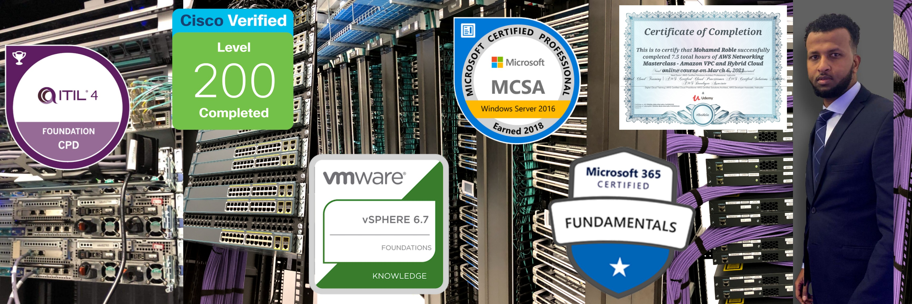

### 👋 Hi there, I'm Roble, a Cloud Computing Engineer.

#### Platform Engineer | AWS - Terraform - CI-CD - Ansible - k8s - Cloud Reliability

I design, automate and operate secure, scalable AWS infrastructure, with a focus on Platform Engineering, IaC, developer enablement and operational reliability. 

My work spans cloud networking, container platforms, infrastructure automation, CI-CD, observability and incident response. I enjoy turning complex infrastructure into repeatable, well-documented systems that engineering teams can deploy and maintain with confidence. 

> From cloud infrastructure to CI-CD and reliable operations - building platforms that engineers can trust.

### 🚀 What I Do
Currently working at BJSS-CGI, my experience includes:

* **Cloud platforms:** Designing and maintaining AWS infrastructure, networking, IAM and application hosting.
* **Infrastructure as Code:** Developing Terraform configurations and modules, using Terragrunt for environment orchestration and promotion.
* **Delivery automation:** Building and improving infrastructure deployment workflows with Jenkins, CircleCI and AWS-native tooling.
* **Containers and orchestration:** Working with Docker, Amazon ECS and Fargate, including service configuration and health checks.
* **Reliability and operations:** Improving CloudWatch monitoring, investigating incidents and working with operational alerting workflows.
* **Security and cost:** Evaluating IAM permissions, network controls, AWS service configurations and infrastructure costs.

-------------

## 🔧 My Toolbox

### ☁️ Cloud & Infrastructure
- ☁️ **AWS:** EC2, ECS, RDS, S3, VPC, IAM, Lambda, CloudWatch, DynamoDB, EventBridge  
- 🏗️ **IaC:** Terraform (including LZA patterns), Terragrunt  
- 🐳 **Containerization:** Docker, ECS Fargate, EKS  
- 🛰️ **Serverless:** Lambda, API Gateway, S3 hosting  

### 🛠️ DevOps & Automation
- 🤖 **CI/CD:** Jenkins, AWS CodePipeline, CircleCI  
- 🔄 **Config Management:** Bash, Ansible  
- 📈 **Monitoring & Logging:** CloudWatch, Grafana, OpsGenie, Splunk  

### 🧰 Tools & Practices
- 🗂️ **Version Control:** Git, GitHub, Bitbucket  
- 🤝 **Agile Workflow:** Jira, Confluence
- 🛡️ **Security:** IAM, OIDC federation, Security Groups, Vault, WAF, NACL
- 🧩 **Architecture Design:** draw.io, Lucidchart  

## 💬 A Bit More About Me

- Passionate about **cloud innovation** and enabling teams to deliver faster, safer, and smarter.  
- Frequently work on **cost optimization**, **security hardening**, and **performance tuning**.  
- Comfortable analyzing existing infrastructure and adapting solutions based on **business needs**.  
- Currently exploring **Python for AWS scripting** and **cloud-native observability** patterns.  

## 📚 Projects & Learning

- Working on uploading several **AWS-based project scenarios**, including a **school simulation app (Hodan School)** to demonstrate infrastructure patterns and DevOps pipelines.  
- Actively expanding my knowledge in **advanced AWS services** and **cloud architecture best practices**.

#### Arday Ultimate Cloud Platform

##### AWS | Terraform | Docker | ECS Fargate | GitHub Actions | CloudWatch

An independently built, production-style AWS platform that demonstrates infrastructure provisioning, application delivery, security controls and cloud operations.

**Architecture highlights:**

- Multi-AZ VPC architecture with public and private subnets.
- Application Load Balancer and container-based workloads.
- Infrastructure management using Terraform.
- GitHub Actions deployment pipeline using AWS OIDC authentication.
- Docker images stored in Amazon ECR and deployed to ECS Fargate.
- CloudWatch metrics, logs, alarms and operational troubleshooting.
- HTTPS, DNS and application routing using AWS services.

**Engineering focus:** Understanding not only how to deploy infrastructure, but also how to secure, observe, troubleshoot and evolve it.

📁 View architecture and case study 

## 📫 Let’s Connect

- I’m open to collaborating on **AWS infrastructure**, **Terraform automation**, and **cloud-native projects**.  
- Looking forward to growing with and contributing to **cloud engineering communities**.  

 

 
 

  
<!--
**MoRoble/MoRoble** is a ✨ _special_ ✨ repository because its `README.md` (this file) appears on your GitHub profile.

Here are some ideas to get you started:

- 🔭 I’m currently working on Projects on AWS cloud solutions
- 🌱 I’m currently learning Terraform
- 👯 I’m looking to collaborate on cloud computiong
- 🤔 I’m looking for help with ...
- 💬 Ask me about ...
- 📫 How to reach me: ...
- 😄 Pronouns: ...
- ⚡ Fun fact: ...
-->

